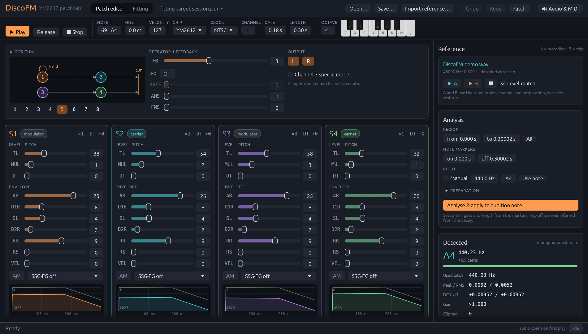

# DiscoFM — YM2612 Instrument Forge

DiscoFM 1.0.0 is a Rust application for reconstructing and editing Mega Drive FM
instruments. It provides deterministic hardware synthesis, validated FM
parameters, CPAL playback, an egui desktop editor and chip envelope traces.
WAV/sample-bank reference analysis includes A/B comparison; staged automatic
fitting supplies locks, cancellation, ranked candidates and refinement history.

## Meet DiscoFM



The desktop editor brings patch design, listening and reference analysis into
one workspace. Edit the four operators and their routing, audition the result
on the YM2612/YM3438 synthesis core, then compare it with an imported recording.
Automatic fitting searches for a patch from the selected reference region;
locks and candidate history keep the search under your control.

- **Design and play:** register controls, chip envelope traces, an on-screen
  keyboard, MIDI input and a local patch library.
- **Compare and reconstruct:** WAV and sample-bank import, pitch and spectral
  analysis, level-matched A/B playback and staged automatic fitting.
- **Save and exchange:** sessions with search history, TFI/VGI/TYI instruments
  and command-line rendering, validation and fitting.

The screenshot shows the included
[fitting target session](examples/fitting-target-session.json) alongside a
synthetic reference rendered from that patch.

## Build on Windows x64

The Windows build needs stable Rust with the MSVC target, a Windows SDK and
Visual Studio Build Tools with **Desktop development with C++**. MSVC is located
automatically by Cargo's `cc` dependency. The accurate synthesis core is vendored
C, so a C compiler is necessary; building requires no emulator download or
external DLL. Even on systems whose default is nightly, `rust-toolchain.toml`
selects stable.

```powershell
cargo build --release --locked
cargo run -- --help
```

The build produces two executables in `target/release`: `discofm-gui.exe` opens
the editor without a console window (pass a session `.json` and/or a reference
file to open them), and `discofm.exe` is the command-line tool, which also opens
the editor with `gui` or no arguments. Other platforms need a supported
C compiler and Rust toolchain; only Windows x64/MSVC has been tested so far.
Application licensing follows the repository's GPLv3 license. The vendored
Nuked-OPN2 library retains LGPL-2.1-or-later; see [third-party notices](THIRD_PARTY_NOTICES.md).

## Automated builds

The [Rust builds workflow](.github/workflows/build.yml) uses nightly Rust on
native GitHub-hosted runners for these targets:

| Platform | Architecture | Rust target |
| --- | --- | --- |
| Windows | x86_64 | `x86_64-pc-windows-msvc` |
| Windows | ARM64 | `aarch64-pc-windows-msvc` |
| Linux | x86_64 | `x86_64-unknown-linux-gnu` |
| Linux | ARM64 | `aarch64-unknown-linux-gnu` |
| macOS | Intel | `x86_64-apple-darwin` |
| macOS | Apple Silicon | `aarch64-apple-darwin` |

Pushes, pull requests and manual runs build release CLI/editor binaries,
compile tests and check CLI startup. Each successful target uploads a
`DiscoFM-<target>` artifact containing a `.tar.gz` package with both executables,
license notices and build metadata. The `DiscoFM-source` artifact contains the
same revision's application, native cores and vendored Cargo dependencies,
including their license files and Cargo configuration for offline builds.
`BUILD.txt` in each binary package links to that source artifact. Keep the
corresponding source and notices available when redistributing binaries.

The [Rust checks workflow](.github/workflows/quality.yml) runs formatting,
Clippy, API documentation checks and the test suite on Windows x64 with stable
and nightly Rust. Both workflows treat compiler and documentation warnings as
errors. The local default in `rust-toolchain.toml` remains stable. CI build
results establish compilation coverage; desktop, audio, MIDI and GPU behavior still need testing on each
platform. macOS artifacts are unsigned command-line executables, including
the GUI launcher; they are not notarized application bundles.

Linux builds require a C/C++ compiler, `pkg-config` and the audio, window-system
and graphics development libraries listed in the build workflow. At runtime,
audio and desktop libraries must be installed; native file dialogs use an
XDG Desktop Portal backend and Zenity. macOS builds require the Xcode command
line tools.

## Desktop editor and reference analysis

```powershell
cargo run -- gui
cargo run -- gui --session examples/basic-session.json --reference target/discofm-demo-ym2612.wav
```

Running `discofm.exe` with no arguments also opens the editor. The window has a
header (Open/Save/Import, **Patch editor**/**Fitting** views, audio output), an
audition strip (note, fine tune, velocity, chip, clock, channel, gate, length,
octave and an on-screen keyboard), the reference panel on the right and a status
bar. Four colored operator cards expose TL/MUL/DT, AR/D1R/SL/D2R/RR/RS, velocity
depth, AM and every SSG-EG encoding as register sliders. The routing diagram
follows the selected hardware algorithm; hover the 1–8 buttons to preview each
one. Feedback, global LFO, AMS/FMS, stereo and channel 3 frequencies sit beside
it. Curves show sampled raw/effective attenuation from the actual chip, including
release and SSG-EG. Every control has a tooltip describing the register; plots
show a value read-out under the pointer. Click a numeric value to type it; drag
it for incremental changes.

Import or drop a WAV without a duration, sample-rate or channel-count opening
limit. PCM/float, extensible, RIFX/RF64, MS/IMA ADPCM, A-law/μ-law and complete
Vorbis ACM streams are supported. Multichannel sources fold to the mean of all
channels; mono/stereo preserve their rate, gain and phase. Unsupported codecs and
malformed files report explicit errors. Memory remains proportional to decoded
audio. Select up to 30 seconds anywhere in a long file for analysis.
Import **SF2/SF3/SFZ/DLS** banks through the same dialog or drag and drop.
Search and select an internal sample, hear its complete PCM with **Play whole
sample**, or use it for analysis/A/B/fitting. Sessions retain the selected
sample. This extracts bank samples; it does not synthesize MIDI presets.
See [supported soundfont formats and CLI commands](docs/SOUNDFONTS.md).

Choose the channel, selected-region DC correction, optional normalization,
silence trimming and FFT sizes 512–8192 for analysis. Available views include
waveforms, spectra, STFT spectrograms, RMS/peak envelopes, harmonic levels,
centroid, spectral flux and transient candidates. A monophonic YIN estimate over
20–4000 Hz, followed by bounded spectral fine tuning, supplies pitch. A frequency
or note can also be entered manually. Results may be ambiguous for noise,
polyphony, inharmonic sounds and very short notes.

`▶ A` (reference) and `▶ B` (chip) restart their clips through the same CPAL output.
Plots and A/B use the same selected interval, channel, DC setting, reference
normalization and 48 kHz analysis. Optional volume matching applies one RMS gain
to B; common playback attenuation prevents clipping. Original PCM and chip
registers remain unchanged. Timing markers are manual; applying them uses the
nearest MIDI note plus cents and starts synthesis at time zero.
**Analyse & apply to audition note** explicitly requests analysis,
then applies pitch and manual timing markers. A completed analysis without stable
pitch reports that result and suggests a manual Hz/note instead of waiting forever.
The application does not infer key-off from a decay.

Play notes with the on-screen piano or `Z S X D C V G B H N J M ,`; releasing the
key or pointer sends key-off to the chip. The selected MIDI note is held by **Play**
until **Release**/Space. **Stop**/Esc or focus loss stops playback. Editing and
analysis need no output device because audio opens on demand. A worker handles
file operations, native preview rendering and FFT/pitch analysis, and new edits
invalidate earlier preview work. Instrument, audition settings, reference path,
analysis preparation and timing markers are saved in sessions. Existing v1
sessions remain loadable.

**Undo/redo** (header buttons, Ctrl+Z / Ctrl+Y or Ctrl+Shift+Z) cover every patch edit; a
drag or a typed value is one step, and applying a candidate, pasting, importing or
loading from the library are steps too. Ctrl+S saves. The header marks a session
with unsaved changes (•), and closing the window then asks to save, discard or
cancel. The **Patch** menu copies the patch to the clipboard as text and pastes it
back (also Ctrl+C / Ctrl+V outside text fields), so a patch moves between
sessions or between two DiscoFM windows; it also imports TFI/VGI/TYI instruments
and exports them (see [instrument export](#instrument-export)). The **patch
library** is a folder (default `Documents\DiscoFM Patches`, or `DISCOFM_LIBRARY`)
of sessions and tracker instruments: **Add** saves the current patch under a name,
a click loads one. **Audio & MIDI** also selects a MIDI keyboard: note on/off with
velocity on any channel plays the monophonic audition voice.

See [analysis methods and limits](docs/REFERENCE_ANALYSIS.md) and
[features and verification](docs/STATUS.md).

## Automatic fitting

To start a search, open **Fitting**, import a reference and select its region and
note-on/key-off. Basic mode varies all unlocked algorithms, feedback,
multipliers, TL and detune. Envelopes/RS, SSG-EG, LFO and AM/FM sensitivities join
the search in Advanced mode. New advanced runs compare LFO/vibrato, AM/tremolo
and channel 3 special mode automatically, each under its own Auto/Preserve
policy. Individual locks retain register values and override automatic
selection. The score and special frequencies are guided by pitch and
inharmonic partial trajectories.

The worker reports stage, evaluations, renders and best loss; cancellation keeps
completed candidates. Results contain ranked patches, component losses and a
convergence graph. Apply a selected patch, apply and audition it, or refine it
using the current reference/settings. The editor changes only when applied.
Sessions retain up to eight runs and sixteen candidates per run; the convergence
curve keeps at most 256 points, thinned evenly over the whole run with the start of
every stage. `--adaptive true` or the **Self-adapting F/CR** box lets each
population member adapt its own F and CR (jDE); it is off by default because it
did worse than the fixed values on longer test runs. **CPU** is the default and, with a fixed seed, reproduces decisions
for the same input/build. **Auto** and **GPU** are experimental: Auto measures
concurrent CPU/GPU spectral work before choosing; GPU explicitly requests wgpu FFT
and spectral-loss reductions. Nuked-OPN2 synthesis, resampling and
scoring run on a pool of CPU workers kept for the whole run (`--workers 0` selects
every logical CPU, up to 16). Chip synthesis dominates fitting time and stays on
the CPU, so the GPU can only shorten the small spectral share of each evaluation.

After an unexpected editor exit, a dialog gives the crash report's name.
`logs/discofm.log` and `logs/crash-*.txt` sit next to `discofm.exe` (or under
`%LOCALAPPDATA%\DiscoFM\logs` when that folder is read-only); the **Log** button
beside an error opens the folder. Send those files to the developer.

A single recording gain can be compensated across the whole note in new runs,
preventing a normalized WAV from forcing saturated operators. When the absolute
recorded level is known, disable **Compensate recording gain**. Fine tuning keeps
its cents through to the actual FNUM/BLOCK registers in offline and live use.
Plots and clips receive the same single B gain from **Level-match**. Both the
editor and `fit` default key-off to the selected region's end, unless markers
were saved in the session or `--key-off` is supplied. Notes are therefore not
all cut at 0.5 seconds.

```powershell
cargo run -- render --session examples/fitting-target-session.json --output target/fitting-reference.wav
cargo run -- fit --reference target/fitting-reference.wav --session examples/fitting-initial-session.json --output target/fitted.json --pitch 440 --key-off 0.18 --end 0.3
cargo run -- fit --reference target/fitting-reference.wav --session target/fitted.json --output target/refined.json --refine-candidate 1
cargo run -- fit --reference sample.wav --output target/basic-fit.json --mode basic --evaluations 512 --population 16 --lock s4.mul --lock algorithm
cargo run --release -- fit --reference sample.wav --output target/gpu-fit.json --compute gpu --workers 8 --lfo auto --am auto --channel3 auto --match-level true --key-off 0.2
```

Drums and noise rarely have a stable pitch. **Percussion / unpitched** (or
`--unpitched true`) skips pitch detection and keys the patch on its body: the
lowest spectral peak within 6 dB of the strongest one (or `--pitch`), like a keyed
drum patch, and switches to band-energy loss weights. Keep
`--channel3 preserve` when the patch must play on any channel; special-mode
frequencies are channel-3 only and do not transpose.

```powershell
cargo run --release -- fit --reference snare.wav --output target/snare-fit.json --unpitched true --channel3 preserve --pitch 261.63
```

Cancel CLI fitting with Escape/Ctrl+C, or use `--cancel-after` in scripts.
Each output must be a new JSON file. Chip renders are scored against
a shared multi-resolution spectral/temporal objective. Lower loss means an
improvement under that objective, without proving a unique original patch or
guaranteeing perceptual identity. Consult [fitting methods](docs/FITTING.md) and
[SteelDrum validation](docs/AUTO_MODES_GPU.md). A ready example with two
comparison runs is [steeldrum-fitted-session.json](examples/steeldrum-fitted-session.json).

## Instrument export

```powershell
cargo run -- export --session target/fitted.json --output target/fitted.tfi
cargo run -- import-instrument downloaded.vgi --output target/imported.json
```

Instruments export to the tracker formats that
[GENNY](https://github.com/superjoebob/genny) writes, which TFM Music Maker,
VGM Music Maker, Deflemask and Furnace read; the extension picks the format:

| Format | Size | Stores | Leaves out |
|---|---|---|---|
| `.tfi` (TFM Music Maker) | 42 bytes | algorithm, feedback, all operator registers | AM enable, AMS/FMS, panning |
| `.vgi` (VGM Music Maker) | 43 bytes | TFI plus AMS/FMS and AM | panning |
| `.tyi` (register dump, "YI") | 32 bytes | VGI plus panning | — |

None stores the global LFO enable/rate, channel 3 special frequencies or the
editor's velocity depth; the CLI and the status bar list what a file left out.
Operators are written in register order (S1, S3, S2, S4), as these formats
define. TFI/VGI detune "−0" (raw 4) is written as 0, which sounds the same. TYI
files from GENNY leave the pan bits clear; DiscoFM writes them, and reads files
without them as centred. `import-instrument` turns any of the three into a new
session; the editor imports them through **Patch → Import instrument…**.

## Terminal playback

```powershell
cargo run -- devices
cargo run -- play
cargo run -- play --session examples/channel3-session.json --octave 4 --profile ym3438
```

Output names, stable IDs and default configurations are printed as JSON by
`devices`. Playback opens the system default output in its mix format. To pick
another endpoint, pass `--device "<ID from devices>"`; to request a supported
rate, pass `--sample-rate 44100`. The actual rate, channels, format, device buffer
size and prepared PCM queue size are printed by the command. Playback needs
neither an external emulator DLL nor a pre-rendered WAV.

In an interactive terminal:

| Control | Action |
|---|---|
| `Z S X D C V G B H N J M ,` | Chromatic notes from C to the next C |
| Enter | A in the selected octave |
| Release the note key | Key-off with the instrument's real envelope tail |
| Space | Release the current note |
| Esc | Stop and discard pending note audio |
| `[` / `]` | Lower/raise octave; default 4, C4 = MIDI 60 |
| Tab | Toggle YM2612 discrete / YM3438 |
| R | Reload the instrument from `--session` |
| Q / Ctrl+C | Quit |

Auditioning is monophonic: each trigger starts a fresh deterministic voice.
Releasing an older key cannot stop a newer note. Octave changes affect the next
trigger; profile changes restart a held note and end an already released tail.
Reload validates the patch before applying it and restarts a held note; audition
profile, clock, channel, octave and velocity remain selected. Special patches
must match the channel selected when playback opened. `--velocity 0..127`
overrides the session's audition velocity, using the instrument's configured TL
response. High notes that exceed the chip's
fundamental pitch range return an error. Focus loss stops playback.
Windows supplies native key-release events. Other platforms need a terminal
with keyboard enhancement support; otherwise Space/Esc provide manual release.

For scripts or terminals without keyboard events:

```powershell
@('on 69', 'wait 400', 'off', 'wait 200', 'octave 5', 'on A',
  'wait 400', 'profile ym3438', 'wait 400', 'stop', 'status', 'quit') |
  cargo run -- play --commands
```

Line commands are `on <MIDI number|C/C#/D/.../B>`, `off`, `stop`,
`octave <-1..8>`, `profile <ym2612|ym3438|toggle>`, `reload`,
`wait <0..5000 ms>`, `status` and `quit`. EOF stops playback. Named notes use the
selected octave; absolute and named notes use the same audition velocity.

Synthesis and sinc conversion run on a worker. The device callback consumes a
bounded ring, converts samples and writes silence on underrun. The default
prepared PCM queue is 40 ms; `--queue-ms 10..100` trades responsiveness for
scheduling tolerance. Total latency also includes a native worker block (up to
128 frames, about 2.4 ms), filter lookahead and the device's buffering. Stop
invalidates queued frames; audio already committed to the device follows that
device's latency. `status` reports callbacks, frames, underruns and nonfatal
backend notifications. Increase the queue if the system cannot keep up. Fatal
device errors mute and report a failure; rerun with an available output to reopen.

## Render and inspect

```powershell
cargo run -- render --output target/note.wav --note 69 --key-on 0.5 --seconds 1
cargo run -- render --output target/note-3438.wav --profile ym3438 --clock pal --sample-rate 44100
cargo run -- render --output target/traced-note.wav --trace target/register-trace.json
cargo run -- validate
```

Existing output destinations, including file links, are rejected so commands
cannot truncate source sessions or earlier outputs. WAV output is stereo 32-bit
IEEE float at fixed gain, without normalization, dither or added noise.
Algorithm 7 with a single audible carrier supplies the default patch; it is not
PCM. MIDI numbers (69=A4) are used as a pitch convention, without implying a
MIDI subsystem. Pitch rounds to valid FNUM/BLOCK values, and extremely high MIDI
notes outside the MUL=1 fundamental range report an error rather than silently
changing pitch. Offline notes allow at most 30 seconds, with output rates of
8–192 kHz. Quantizing durations to complete native frames means conversion can
produce one more output sample than the requested wall-clock duration.

## Internal sessions

```powershell
cargo run -- new-session --output target/my-session.json
cargo run -- inspect-session --session target/my-session.json
cargo run -- render --session target/my-session.json --output target/edited-note.wav
cargo run -- inspect-session --session examples/channel3-session.json
```

Edit a copy of [the example session](examples/basic-session.json) to change all
four operators, algorithm, feedback, global LFO, AMS/FMS, SSG-EG, stereo routes,
velocity attenuation or channel-3 frequencies. JSON contains raw hardware values;
out-of-range fields and unsupported session versions are rejected. Errors identify
nested fields, for example `instrument.operators[2].ar`. Existing version 1
sessions remain compatible. Validation also rejects contradictory channels and
unrepresentable audition pitches when reading a session. Special-mode
patches require audition channel 3. `channel3_special` stores three `[FNUM,BLOCK]`
pairs in S1/S2/S3 order; S4 follows the audition note. Sessions are DiscoFM's
working format; use [instrument export](#instrument-export) for other tools.

`inspect-session` prints JSON with the algorithm's modulation edges and carriers,
raw algorithm number (0–7), display number (1–8), and actual registers decoded
from the loaded chip before key-on. The engine also exposes read-only envelope
and phase snapshots used by the editor traces. [The channel-3 example](examples/channel3-session.json)
demonstrates three independent frequencies while S4 follows the audition note.

## Current verification and limits

```powershell
cargo fmt --all -- --check
cargo clippy --workspace --all-targets -- -D warnings
cargo test --workspace
```

Regression tests cover exhaustive scalar/frequency limits, register mappings,
six channels, eight algorithms and their audible carriers/causal modulation
paths, all enabled SSG-EG shapes and release, LFO/AM/FMS gating, native envelope
stages and key scaling, each channel-3 operator pitch, key-off,
stereo, detune signs, MUL=0, native timing, measured pitch, profile isolation across
threads, low-level output, DAC mode, resampling and session/CLI validation.
Live native frames match offline rendering exactly across both clocks, profiles
and all six channels, including immediate release. Streaming sinc samples match
offline conversion from 8 to 192 kHz. Transport tests cover full queues, stale
key-up, profile changes, Stop, shutdown and device-error muting.

Short generated notes are played by the optional Windows device test, which
checks WASAPI loopback entirely in memory. Before running it, pause audio from
other applications:

```powershell
cargo test -p discofm-audio --test device_smoke -- --ignored --nocapture
```

The check covers the OS mix path, including profile tones, octave, release and
Stop, without measuring physical speaker output. Normal tests omit it because
a real output device and a quiet mixer are required.

Without recording, the separate opt-in clip test briefly plays quiet A/B tones
and checks complete consumed frame counts, EOF silence, switching and Stop:

```powershell
cargo test -p discofm-audio --test clips_device -- --ignored --nocapture
```

Exact stereo pin streams are compared by `validate` against a separate C driver
calling the same pinned upstream core. This establishes integration agreement;
it does not independently prove physical-chip accuracy. An independent audio
comparison against pinned ymfm also runs. Upstream explicitly marks the discrete
DAC/ladder branch as unverified, and no physical-chip recordings have been
supplied. This backend does not support RAW_DIAGNOSTIC; the engine API provides
exact pin capture instead.

```powershell
cargo run --release -- compare --session examples/basic-session.json
cargo run --release -- compare --session patch.json --reference hardware-note.wav --start 0.25 --align-ms 2 --match-level --output target/hardware-report.json
```

`compare` reports spectrum, 40 ms envelope, RMS, dominant peaks and waveform
differences. ymfm uses fixed profile calibration; recording alignment/gain are
explicit options. See [precision and performance](docs/PRECISION_PERFORMANCE.md).

Fitted examples use relative paths to external FL Studio WAVs:
[BASS_EfEm_C2](examples/bass-efem-fitted-session.json) and
[STR_MandoLynn_B2](examples/mandolynn-fitted-session.json). See
[example setup](examples/README.md) for reference-file locations and reproduction.

Read [hardware accuracy](docs/HARDWARE_ACCURACY.md),
[parameter mapping](docs/PARAMETER_MAPPING.md),
[architecture](docs/ARCHITECTURE.md) and [release status](docs/STATUS.md).

## License

DiscoFM's application code is licensed under **GPL-3.0-only**; see
[LICENSE.txt](LICENSE.txt). Third-party libraries and bundled fonts retain their
own licenses and copyright notices. See [third-party notices](THIRD_PARTY_NOTICES.md)
and the [dependency inventory](docs/DEPENDENCIES.md) for compatibility and
redistribution requirements. Copyrighted sample-bank and FL Studio audio is not
included in this repository.
